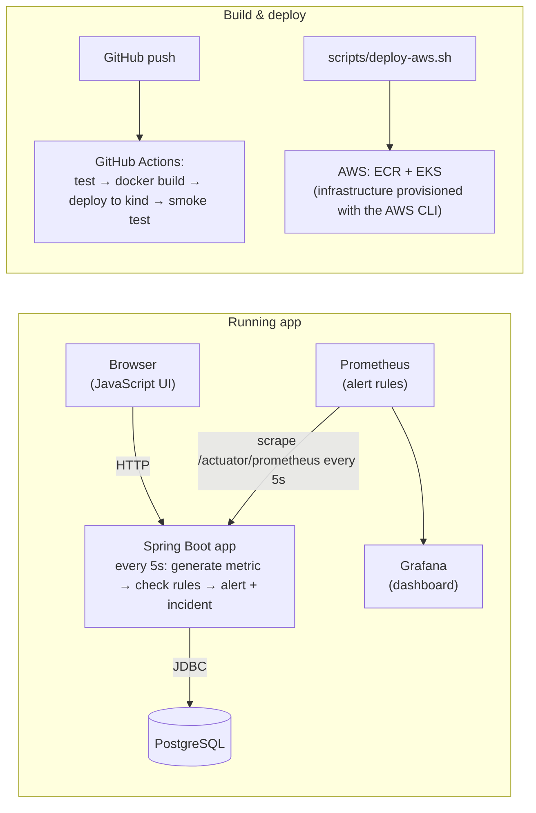

# CloudPulse

A cloud-hosted service reliability and incident-response application.

CloudPulse simulates three services (**Payment API**, **Authentication API**, **Order API**). Every 5 seconds
it generates telemetry for them, stores it in PostgreSQL, opens alerts and incidents when a threshold is
breached, and lets an operator acknowledge and resolve those incidents from a web UI. Prometheus and Grafana
watch the same numbers from the outside.

---

## Architecture



---

## 1. Run with Docker Compose

```bash
docker compose up --build     # Builds the image and starts PostgreSQL + CloudPulse
```

Open http://localhost:8080. Stop with `docker compose down`. The database is not kept between runs.

### Environment variables

| Variable | Meaning | Default when unset |
|---|---|---|
| `DB_URL` | JDBC URL of the database | `jdbc:postgresql://localhost:5432/cloudpulse` |
| `DB_USERNAME` | database username | `postgres` |
| `DB_PASSWORD` | database password | `postgres` |

## 2. Run the tests

```bash
./mvnw test     # 3 unit tests of the monitoring logic; no database needed
```

## 3. Run on local Kubernetes (kind)

**One command** (creates the cluster, builds and loads the image, deploys PostgreSQL, CloudPulse,
Prometheus and Grafana, then waits until the app is ready). Run `kind delete cluster --name cloudpulse` first
if the cluster already exists:

```bash
./scripts/setup-local.sh
```

Steps in the script:

```bash
kind create cluster --name cloudpulse
docker build -t cloudpulse:local .
kind load docker-image cloudpulse:local --name cloudpulse   # copy the image into the cluster

kubectl apply -f k8s/namespace.yaml
kubectl apply -f k8s/
kubectl -n cloudpulse rollout status deployment/cloudpulse   # wait until the app is ready

kubectl -n cloudpulse port-forward svc/cloudpulse 8080:8080  # then open http://localhost:8080
```

## 4. Add Prometheus and Grafana

(`setup-local.sh` already does this.)

```bash
kubectl apply -f monitoring/
kubectl -n cloudpulse port-forward svc/prometheus 9090:9090   # http://localhost:9090  (Alerts tab)
kubectl -n cloudpulse port-forward svc/grafana 3000:3000      # http://localhost:3000  (login admin / admin)
```

Alert rules (in `monitoring/prometheus.yaml`), each of which must hold for 30 seconds before it fires:

| Alert | Condition |
|---|---|
| `CloudPulseHighLatency` | simulated latency > 1000 ms |
| `CloudPulseHighErrorRate` | simulated error rate > 10% |

## 5. CI/CD (GitHub Actions)

`.github/workflows/ci.yml` runs on every push to `main`:
test → build image → create a temporary kind cluster → deploy → check the API.
A failing test stops the pipeline before anything is deployed. Results are in the repository's **Actions** tab.

## 6. AWS: EKS

The infrastructure is created with the AWS CLI. In `us-east-1`, it needs:
- an EKS cluster named `cloudpulse-eks`
- an ECR repository named `cloudpulse`

**Prerequisites:** AWS CLI v2, plus an IAM Identity Center (SSO) login. **Don't use root access keys.**

```bash
aws configure sso --use-device-code          # once; profile name: cloudpulse
aws sso login --profile cloudpulse           # when the session has expired
export AWS_PROFILE=cloudpulse

# 1. Create the EKS cluster and ECR repository with the AWS CLI (see above).

# 2. Deploy: pushes the image to ECR (tagged with the commit), applies k8s/ + monitoring/, waits until ready
./scripts/deploy-aws.sh

# 3. Use it privately (nothing is exposed to the internet)
kubectl --context cloudpulse-eks -n cloudpulse port-forward svc/cloudpulse 8080:8080

# 4. Remove the app by deleting its namespace. THIS DELETES THE DATABASE.
./scripts/destroy-aws.sh
# 5. Then delete the cluster and ECR repository with the AWS CLI to stop all charges.
```

Run `deploy-aws.sh` once per commit (ECR tags can't be pushed twice). Both scripts leave your default
`kubectl` context unchanged (AWS is only reached through `--context cloudpulse-eks`).

---

## API

| Method | Path | What it does |
|---|---|---|
| GET | `/api/services` | the three services and their status |
| GET | `/api/services/{id}/metrics` | the newest reading for a service |
| GET | `/api/incidents` | incidents, newest first |
| POST | `/api/incidents/{id}/acknowledge` | sets the incident to ACKNOWLEDGED |
| POST | `/api/incidents/{id}/resolve` | sets the incident to RESOLVED |
| GET | `/api/simulation` | which services are currently in a failure mode |
| POST | `/api/simulation/latency-spike?service=…` | latency 1500 ms |
| POST | `/api/simulation/error-spike?service=…` | error rate 25% |
| POST | `/api/simulation/outage?service=…` | latency 3000 ms and 90% errors, so the status is DOWN |
| POST | `/api/simulation/restore?service=…` | every service back to normal |
| GET | `/actuator/health` | health, including the database connection |
| GET | `/actuator/prometheus` | metrics for Prometheus |

**Status rules:** DOWN if error rate ≥ 50%; DEGRADED if latency > 1000 ms or
error rate > 10%; otherwise HEALTHY.

---

## Demo (about 3 minutes)

1. Open the CloudPulse UI: all three services are **HEALTHY**.
2. Show the GitHub Actions run for the latest commit (tests → build → deploy → smoke test).
3. Click **Latency spike** for Payment API. Within 5 seconds the service becomes **DEGRADED** and an **OPEN** incident appears.
4. In Prometheus → Alerts, `CloudPulseHighLatency` goes *pending*, then *firing* after 30 seconds.
5. In Grafana, the latency line jumps to 1500 ms.
6. In the UI, click **Acknowledge**.
7. Click **Restore all**. The service returns to HEALTHY, the alert is resolved, and the Prometheus alert clears.
8. Click **Resolve** on the incident.
9. Show `scripts/deploy-aws.sh` and explain how the same image and manifests are deployed to EKS.
10. Name a limitation and the next improvement.

---

## Cleanup

```bash
docker compose down                        # Compose: stop and delete the containers
kind delete cluster --name cloudpulse      # Kubernetes: deletes the cluster and everything in it
AWS_PROFILE=cloudpulse ./scripts/destroy-aws.sh   # AWS: removes the app and deletes the database
# then delete the EKS cluster and ECR repository with the AWS CLI to stop all charges
```