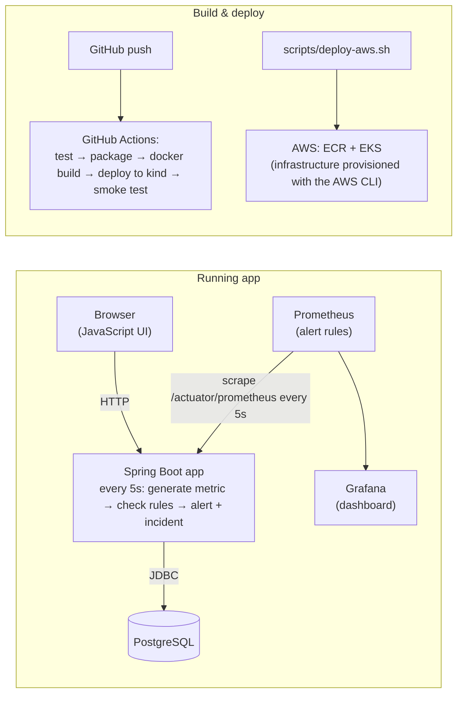

# CloudPulse

A cloud-hosted service reliability and incident-response application.

CloudPulse simulates three services (**Payment API**, **Authentication API**, **Order API**). Every 5 seconds
it generates telemetry for them, stores it in PostgreSQL, opens alerts and incidents when a threshold is
breached, and lets an operator acknowledge and resolve those incidents from a web UI. Prometheus and Grafana
watch the same numbers from the outside.

---

## Architecture



---

## 1. Run with Docker Compose

```bash
cp .env.example .env          # Then change DB_PASSWORD in .env
docker compose up --build     # Builds the image and starts PostgreSQL + CloudPulse
```

Open http://localhost:8080. Stop with `docker compose down`

### Environment variables

| Variable | Meaning | Default when unset |
|---|---|---|
| `DB_URL` | JDBC URL of the database | `jdbc:postgresql://localhost:5432/cloudpulse` |
| `DB_USERNAME` | database username | `postgres` |
| `DB_PASSWORD` | database password | `postgres` |

## 2. Run the tests

```bash
./mvnw test     # 13 tests; uses an in-memory H2 database, so no PostgreSQL is needed
```

## 3. Run on local Kubernetes (kind)

**One command** (creates the cluster, builds and loads the image, creates the DB secret, deploys PostgreSQL,
CloudPulse, Prometheus and Grafana, then checks health; safe to run again):

```bash
./scripts/setup-local.sh
```

Steps in the script:

```bash
kind create cluster --name cloudpulse
docker build -t cloudpulse:local .
kind load docker-image cloudpulse:local --name cloudpulse   # copy the image into the cluster

kubectl apply -f k8s/namespace.yaml
# The database password lives only in the cluster, never in Git:
kubectl -n cloudpulse create secret generic cloudpulse-db \
  --from-literal=username=cloudpulse --from-literal=password="$(openssl rand -hex 16)"
kubectl apply -f k8s/

kubectl -n cloudpulse get pods                              # wait until both are 1/1 Running
kubectl -n cloudpulse port-forward svc/cloudpulse 8080:8080 # then open http://localhost:8080
```

## 4. Add Prometheus and Grafana

(`setup-local.sh` already does this.)

```bash
kubectl apply -f monitoring/
kubectl -n cloudpulse port-forward svc/prometheus 9090:9090   # http://localhost:9090  (Alerts tab)
kubectl -n cloudpulse port-forward svc/grafana 3000:3000      # http://localhost:3000  (CloudPulse Overview)
```

Alert rules (in `monitoring/prometheus.yaml`), each of which must hold for 30 seconds before it fires:

| Alert | Condition |
|---|---|
| `CloudPulseHighLatency` | simulated latency > 1000 ms |
| `CloudPulseHighErrorRate` | simulated error rate > 10% |
| `CloudPulseTargetDown` | Prometheus cannot scrape the app |

## 5. CI/CD (GitHub Actions)

`.github/workflows/ci.yml` runs on every push and pull request to `main`:
test → upload test reports → package → build image `cloudpulse:<commit>` → create a temporary kind cluster →
deploy → check readiness and the API. A failing test stops the pipeline before anything is deployed.
Results are in the repository's **Actions** tab. The AWS (ECR/EKS) steps are present but commented out.

## 6. AWS: EKS

The infrastructure is created with the AWS CLI. It needs:
- an EKS cluster named `cloudpulse-eks` with the **EBS CSI driver** add-on (so Postgres gets an encrypted gp3 disk)
- an ECR repository named `cloudpulse` (immutable tags, scan on push)

Different names or region? Set `CLUSTER=…` and/or `REGION=…` (default `us-east-1`) when running the scripts.

**Prerequisites:** AWS CLI v2, plus an IAM Identity Center (SSO) login. **Don't use root access keys.**

```bash
aws configure sso --use-device-code          # once; profile name: cloudpulse
aws sso login --profile cloudpulse           # when the session has expired
export AWS_PROFILE=cloudpulse

# 1. Create the EKS cluster and ECR repository with the AWS CLI (see above).

# 2. Deploy: pushes the image to ECR (tagged with the commit), applies k8s/ + k8s/aws/ + monitoring/, checks health
./scripts/deploy-aws.sh

# 3. Use it privately (nothing is exposed to the internet)
kubectl --context cloudpulse-eks -n cloudpulse port-forward svc/cloudpulse 8080:8080

# 4. Remove the app. Deletes the namespace so the Postgres EBS disk is removed too. THIS DELETES THE DATABASE.
./scripts/destroy-aws.sh
# 5. Then delete the cluster and ECR repository with the AWS CLI to stop all charges.
```

Both scripts are safe to re-run, and `deploy-aws.sh` leaves your default `kubectl` context unchanged
(AWS is only reached through `--context cloudpulse-eks`).

---

## API

| Method | Path | What it does |
|---|---|---|
| GET | `/api/services` | the three services and their status |
| GET | `/api/services/{id}` | one service (404 if missing) |
| GET | `/api/services/{id}/metrics` | the 50 newest readings for a service |
| GET | `/api/alerts?status=OPEN` | alerts, optionally filtered by status |
| GET | `/api/incidents` / `/api/incidents/{id}` | incidents (404 if missing) |
| POST | `/api/incidents/{id}/acknowledge` | OPEN → ACKNOWLEDGED (otherwise 409) |
| POST | `/api/incidents/{id}/resolve` | OPEN/ACKNOWLEDGED → RESOLVED (409 if already resolved) |
| GET | `/api/simulation` | which services are currently in a failure mode |
| POST | `/api/simulation/latency-spike?service=…` | latency 1500 ms (default service: Payment API) |
| POST | `/api/simulation/error-spike?service=…` | error rate 25% |
| POST | `/api/simulation/outage?service=…` | latency 3000 ms and 90% errors, so the status is DOWN |
| POST | `/api/simulation/restore` | every service back to normal |
| GET | `/actuator/health` | health, including `/liveness` and `/readiness` |
| GET | `/actuator/prometheus` | metrics for Prometheus |

**Status rules:** DOWN if error rate ≥ 50%; DEGRADED if latency > 1000 ms or
error rate > 10%; otherwise HEALTHY.

---

## Demo (about 3 minutes)

1. Open the CloudPulse UI: all three services are **HEALTHY**.
2. Show the GitHub Actions run for the latest commit (tests → build → deploy → smoke test).
3. Click **Latency spike** for Payment API. Within 5 seconds the service becomes **DEGRADED** and an **OPEN** incident appears.
4. In Prometheus → Alerts, `CloudPulseHighLatency` goes *pending*, then *firing* after 30 seconds.
5. In Grafana, the latency line jumps to 1500 ms, and the open-incident and firing-alert counters go up.
6. In the UI, click **Acknowledge**.
7. Click **Restore all**. The service returns to HEALTHY, the alert is resolved, and the Prometheus alert clears.
8. Click **Resolve** on the incident.
9. Show `scripts/deploy-aws.sh` and explain how the same image and manifests are deployed to EKS.
10. Name a limitation (below) and the next improvement.

The step-by-step operator procedure is in `docs/runbooks/high-latency.md`.

---

## Cleanup

```bash
docker compose down -v                     # Compose: stop and delete the database volume
kind delete cluster --name cloudpulse      # Kubernetes: deletes the cluster and everything in it
AWS_PROFILE=cloudpulse ./scripts/destroy-aws.sh   # AWS: removes the app and deletes the database
# then delete the EKS cluster and ECR repository with the AWS CLI to stop all charges
```